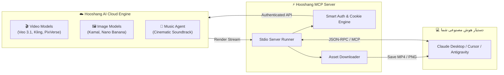

<div align="center">


# 🎬 Hooshang AI MCP Server
### سرور پروتکل کانتکست مدل برای هوش مصنوعی هوشنگ

**Connect Claude Desktop, Cursor, and Antigravity to Iran's Premier Generative AI Engine for Filmmaking, Video Generation, and Music Scoring.**

[](https://github.com/Hesvm/HooshangMCP)
[](LICENSE)
[](https://modelcontextprotocol.io)
[](#)
[](https://nodejs.org)

[📖 راهنمای فارسی](#-راهنمای-فارسی) • [🇬🇧 English Guide](#-english-documentation) • [🛠️ ابزارها](#-ابزارهای-در-دسترس-mcp-tools) • [🎥 مدل‌های پشتیبانی‌شده](#-مدل‌های-ویدیویی-و-تصویری-پشتیبانی‌شده)

---

</div>

<div id="-راهنمای-فارسی"></div>

## 🇮🇷 راهنمای فارسی

**Hooshang AI MCP Server** یک پل ارتباطی قدرتمند و استاندارد متن‌باز مبتنی بر پروتکل **Model Context Protocol (MCP)** است که هوش مصنوعی‌های پیشرو دنیا نظیر:
- **Claude Desktop**
- **Cursor IDE**
- **Antigravity IDE**
- **Claude Code CLI**
- **Cline / Roo Code**

را مستقیماً به زیرساخت هوش مصنوعی **هوشنگ (Hooshang.ai)** متصل می‌کند.

با این سرور، هوش مصنوعی شما تبدیل به یک **دستیار کارگردان و تدوین‌گر ۲۴ ساعته** می‌شود که می‌تواند بر اساس سناریوی شما ویدیوهای B-Roll سینمایی خلق کند، فریم‌های استوری‌بورد بسازد، موسیقی متن اختصاصی بسازد و فایل‌های خروجی را مستقیماً درون پروژه‌تان دانلود کند.

---

### ⚡ راه‌اندازی با ۱ کلیک (۱۰۰٪ خودکار و بدون کار دستی)

برای راه‌اندازی، کاربر **نیازی به باز کردن هیچ فایلی، ویرایش کد JSON یا کپی کردن کوکی ندارد**. فقط کافیست ترمینال سیستم خود (PowerShell، CMD یا Terminal مک) را باز کنید و دستور زیر را اجرا نمایید:

```bash
npx github:Hesvm/HooshangMCP setup
```

#### این دستور تک‌خطی چه کارهایی انجام می‌دهد؟
1. **🔍 استخراج خودکار سشن (Zero-Login):** اگر در مرورگر سیستم‌تان قبلاً در سایت هوشنگ لاگین کرده باشید، سشن شما را در کمتر از ۱ ثانیه از دیتابیس لوکال مرورگر استخراج و اعتبارسنجی می‌کند. (اگر لاگین نبودید، یک پنجره سبک باز می‌شود تا شماره موبایل و کد پیامک را وارد کنید).
2. **⚡ تزریق خودکار تنظیمات MCP:** نرم‌افزارهای **Claude Desktop** و **Cursor** و **Antigravity** را در سیستم شما شناسایی کرده و بدون دست زدن به سایر افزونه‌ها، کانفیگ هوشنگ را به فایل تنظیمات آن‌ها تزریق می‌کند.
3. **تمام!** فقط کافیست Claude یا Cursor را ببندید و دوباره باز کنید.

```bash
# بررسی وضعیت اعتبار، توکن و کاربر متصل
npx github:Hesvm/HooshangMCP status
```

---

### 🏛️ معماری سیستم و جریان کارکرد



---

### 🎨 نمونه خروجی تولید شده با MCP

تصویر زیر نمونه‌ای واقعی است که توسط دستیار هوش مصنوعی مستقیماً از طریق مدل لوکال **کمال (Kamal)** هوشنگ و به وسیله این MCP Server تولید شده است:

<div align="center">
  
  <p><em>نمونه پرامپت: «یک پورشه 911 کلاسیک و قدیمی در جاده کوهستانی هنگام غروب آفتاب با نورپردازی سینمایی» (مدل کمال - زمان تولید: ۲.۵ ثانیه)</em></p>
</div>

---

### 🎥 مدل‌های ویدیویی و تصویری پشتیبانی‌شده

| دسته‌بندی | مدل هوش مصنوعی | هزینه تقریبی | نسبت تصویر | بهترین کاربرد |
| :--- | :--- | :---: | :---: | :--- |
| **ویدیو** | **PixVerse V6** | ۱۴۰ کردیت | ۱۶:۹ / ۹:۱۶ | سریع، اقتصادی، ایده‌آل برای ریلز و شات‌های پویا |
| **ویدیو** | **Luma Dream Machine** | ۲۵۰ کردیت | ۱۶:۹ | حرکات طبیعی دوربین و فیزیک واقع‌گرایانه |
| **ویدیو** | **Google Veo 3.1 Fast** | ۶۰۰ کردیت | ۱۶:۹ / ۹:۱۶ | کیفیت فوق‌العاده سینمایی و جزئیات خارق‌العاده شبیه هالیوود |
| **ویدیو** | **Kling 3 Omni** | ۸۴۰ کردیت | ۱۶:۹ / ۹:۱۶ | بالاترین ثبات چهره و فیزیک پیچیده اشیاء |
| **ویدیو** | **Wan 3.0 / MiniMax** | متغیر | ۱۶:۹ | موشن‌های اکشن و تغییر زاویه پرسرعت |
| **تصویر** | **کمال (Kamal)** | ۵ کردیت | همه نسبت‌ها | مدل لوکال هوشنگ؛ فوق‌العاده سریع و ارزان برای استوری‌بورد |
| **تصویر** | **GPT Image / Nano Banana** | متغیر | همه نسبت‌ها | درک دقیق پرامپت‌های طولانی و مفهومی |
| **صدا** | **Cinematic Music Agent** | بر اساس طول | استریو MP3 | ساخت ساندترک و اتمسفر صوتی صحنه |

---

### 🛠️ ابزارهای در دسترس (MCP Tools)

<table dir="rtl" style="width:100%; border-collapse:collapse; text-align:right;">
  <thead>
    <tr style="background:#21262d; color:#58a6ff;">
      <th style="padding:10px; border:1px solid #30363d;">نام ابزار</th>
      <th style="padding:10px; border:1px solid #30363d;">پارامترهای ورودی</th>
      <th style="padding:10px; border:1px solid #30363d;">توضیحات و عملکرد</th>
    </tr>
  </thead>
  <tbody>
    <tr>
      <td style="padding:10px; border:1px solid #30363d; font-family:Consolas, monospace;"><code>hooshang_generate_video</code></td>
      <td style="padding:10px; border:1px solid #30363d;"><code>prompt</code>, <code>aspect_ratio</code>, <code>model</code>, <code>download_dir</code></td>
      <td style="padding:10px; border:1px solid #30363d;">تولید صحنه‌های ویدیویی با مدل‌های پیشرفته (Veo, Kling, PixVerse) و دانلود خودکار فایل MP4</td>
    </tr>
    <tr>
      <td style="padding:10px; border:1px solid #30363d; font-family:Consolas, monospace;"><code>hooshang_generate_image</code></td>
      <td style="padding:10px; border:1px solid #30363d;"><code>prompt</code>, <code>aspect_ratio</code>, <code>model</code>, <code>download_dir</code></td>
      <td style="padding:10px; border:1px solid #30363d;">تولید فریم‌های استوری‌بورد، تصاویر مفهومی و کاور با مدل کمال (Kamal) و سایر مدل‌ها</td>
    </tr>
    <tr>
      <td style="padding:10px; border:1px solid #30363d; font-family:Consolas, monospace;"><code>hooshang_generate_music</code></td>
      <td style="padding:10px; border:1px solid #30363d;"><code>prompt</code>, <code>duration</code>, <code>style</code></td>
      <td style="padding:10px; border:1px solid #30363d;">تولید هوشمند ساندترک و موسیقی متن بر اساس توصیف حسی صحنه</td>
    </tr>
    <tr>
      <td style="padding:10px; border:1px solid #30363d; font-family:Consolas, monospace;"><code>hooshang_auth_status</code></td>
      <td style="padding:10px; border:1px solid #30363d;">-</td>
      <td style="padding:10px; border:1px solid #30363d;">بررسی زنده وضعیت نشست، هویت کاربر و تاریخ اعتبار</td>
    </tr>
    <tr>
      <td style="padding:10px; border:1px solid #30363d; font-family:Consolas, monospace;"><code>hooshang_download_asset</code></td>
      <td style="padding:10px; border:1px solid #30363d;"><code>file_url</code>, <code>output_path</code></td>
      <td style="padding:10px; border:1px solid #30363d;">دانلود مستقیم هر مدیا با مدیریت پهنای باند و جریان داده</td>
    </tr>
  </tbody>
</table>

---

### 💻 کانفیگ دستی (در صورت عدم استفاده از setup خودکار)

اگر مایلید تنظیمات را دستی درون فایل‌های کانفیگ نرم‌افزارهای خود کپی کنید:

```json
{
  "mcpServers": {
    "hooshang": {
      "command": "npx",
      "args": ["-y", "github:Hesvm/HooshangMCP"]
    }
  }
}
```

- **Claude Desktop ویندوز:** `%APPDATA%\Claude\claude_desktop_config.json`
- **Claude Desktop مک:** `~/Library/Application Support/Claude/claude_desktop_config.json`
- **Antigravity IDE:** `~/.gemini/config/mcp_config.json`
- **Cursor IDE:** `~/.cursor/mcp.json`

---

<div id="-english-documentation"></div>

## 🇬🇧 English Documentation

**Hooshang AI MCP Server** exposes Iran's leading generative video, concept image, and music scoring capabilities directly to your LLM-driven environments (Claude Desktop, Cursor, Antigravity, Cline) through the standard **Model Context Protocol (MCP)**.

### ⚡ Zero-Touch 1-Click Setup

No manual JSON editing or cookie extraction needed. Simply open your terminal and run:

```bash
npx github:Hesvm/HooshangMCP setup
```

This single command:
1. **Auto-detects active Hooshang login** from your local browser cookies in `< 1 second`. (Or launches a lightweight SMS/Google login window if not authenticated).
2. **Auto-configures Claude Desktop, Cursor, and Antigravity** without altering other servers.
3. Simply restart Claude Desktop / Cursor and enjoy!

---

### 🖥️ CLI Commands

| Command | Description |
| :--- | :--- |
| `hooshang-mcp setup` | **All-in-One 1-Click Setup**: Auto-authenticates and configures all AI clients |
| `hooshang-mcp install` | Auto-injects MCP configuration into Claude Desktop, Cursor, Antigravity |
| `hooshang-mcp extract` | Instantly extracts active session token from local browser cookies |
| `hooshang-mcp login` | Smart interactive browser login (SMS OTP / Google) |
| `hooshang-mcp status` | Displays active authentication state, user account, and expiry date |
| `hooshang-mcp token <tok>` | Manually sets session token |
| `hooshang-mcp logout` | Clears stored local credentials |

---

### 🔒 Privacy & Security

- **Local Storage:** All authentication tokens are stored strictly on your local machine (`~/.hooshang-mcp/session.json`) with strict permission bits.
- **Zero Telemetry:** No user data or generated assets are sent to any third-party server besides Hooshang.ai API.
- **Open Source:** Full codebase is transparent and audited for community safety.

---

### 📄 License

Released under the permissive [MIT License](LICENSE).  
Created and maintained with ❤️ by [Hesam Mousavi (Hesvm)](https://github.com/Hesvm).  
Contributions and Pull Requests are welcome!
